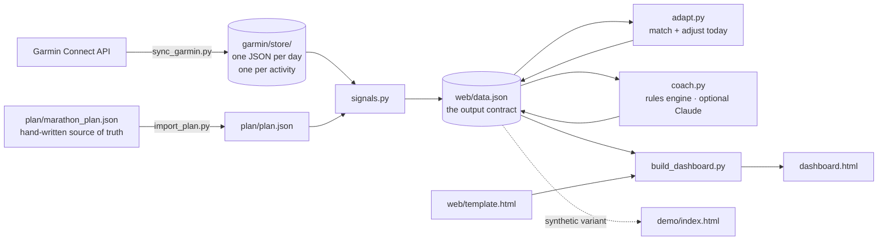

# Endurance training dashboard

A nightly pipeline that pulls my Garmin Connect data, computes the training and
recovery signals the watch doesn't give me, and renders a single self-contained
dashboard for an 8-week marathon block.

`demo/index.html` — the same dashboard on synthetic data · Python 3.12 · no framework, no build step

---

## What it does

Garmin Connect will show you yesterday. It won't tell you whether your training
load is ramping faster than your body is absorbing it, whether this morning's
resting heart rate is meaningful or just noise, or whether your recent running
actually projects to the time you're chasing. Those answers need history and
arithmetic, so this pipeline keeps the history and does the arithmetic.

Every night it:

1. pulls wellness and activity data from Garmin Connect into an append-only store
2. computes the derived signals — training load, acute:chronic workload ratio,
   fitness/fatigue/form, resting-HR and nocturnal-drop baselines, sleep debt, a
   readiness composite, a race projection, and adherence against the plan
3. matches what actually happened against the plan, and adjusts today and
   tomorrow to the recovery signals — without ever rewriting the base plan
4. writes a coach's read of those signals
5. renders `dashboard.html`, which opens with a double-click and needs no server

## Architecture



Each stage reads the previous stage's output from disk and nothing else, so any
stage can be run or debugged on its own.

| File | Job |
|---|---|
| `login.py` | one-time Garmin auth, including the MFA handshake; stores a reusable token |
| `sync_garmin.py` | Garmin API → `garmin/store/` plus readable markdown notes |
| `store.py` | the append-only store: one JSON file per day, one per activity |
| `signals.py` | **the analytical core.** Store + plan → `web/data.json` |
| `adapt.py` | matches activities to the plan, and adjusts today and tomorrow |
| `coach.py` | reads the signals, writes the coach's note |
| `build_dashboard.py` | inlines `web/data.json` into `web/template.html` |
| `plan/marathon_plan.json` | **the plan itself**, as written by hand — the source of truth |
| `plan/import_plan.py` | converts that into the schema the pipeline reads |
| `make_demo_data.py` | synthetic dataset so the project can be shown publicly |
| `run_daily.py` | runs the whole pipeline; called by a launchd job at 06:30 |
| `backfill.py` | one-time historical pull; resumable, stops on a rate limit |
| `log.py` | the manual input channel: sleep, weight, soreness, energy, RPE |
| `healthcheck.py` | decides whether the pipeline is actually working |
| `analyse_readiness.py` | checks whether the readiness model predicts anything |
| `runlock.py` | one pipeline run at a time |
| `tests/test_signals.py` | tests over the signal layer |
| `tests/test_adapt.py` | tests over matching and adaptation |
| `tests/test_nutrition.py` | tests over measured energy and macro targets |
| `tests/test_triathlon.py` | tests over race-split detection and extrapolation |
| `launchd/` | the two scheduled jobs, kept in the repo alongside the code |

## The decisions worth explaining

**The signals are computed in Python, not in the browser.** The interesting
numbers need history: an acute:chronic workload ratio reads 28 days of training
load, and a resting-HR baseline is meaningless against fewer than a few weeks of
mornings. Shipping a month of raw Garmin payloads to the page to recompute that
on every load would be absurd. Computing it once a night also makes it stable,
auditable and testable — `signals.py` is pure functions over plain data.

**Things the sensors can't see get typed in, and are labelled when they are.**
`log.py` is the single manual channel: sleep for nights the watch spent charging,
bodyweight (there is no connected scale, and every macro target scales off it),
and three subjective scores — morning soreness, energy, and session RPE.

The subjective scores earn their weight: perceived soreness and low energy are
among the better predictors of overreaching, and they are the only inputs here
that can see a problem before the heart rate does. RPE also gives an independent
load measure — RPE × minutes is Foster's session-RPE — which the dashboard
compares against heart-rate-derived TRIMP. Heart rate systematically under-reads
in exactly the conditions where it would be most useful: deep fatigue, heat,
illness, dehydration. So when perceived load runs consistently above measured
load, the heart rate is telling a more flattering story than the legs are. That
divergence is the signal, and neither number alone says it.

**Nights the watch missed can be filled in, and are labelled when they are.** A
night spent charging is gone from Garmin permanently — unlike a recorded night,
it is never backfilled. Since sleep and the nocturnal drop carry 45% of the
readiness weight between them, a missing night doesn't just leave a hole in one
chart, it changes what the score is made of. So the dashboard asks: when a night
has no sleep figure, a prompt appears with a box for the hours, and hands back the
exact `log_sleep.py` command. What is and isn't recoverable is kept honest. Duration comes back; sleep stages
are left absent rather than invented from a typical ratio; and the overnight
heart-rate series isn't in any other source, so the nocturnal drop stays
unavailable for those nights whatever you do. Measured Garmin data always wins
over a hand-entered figure, and filled nights are drawn in a different colour on
the sleep chart so an estimate never passes for a measurement.

(An Apple Health importer was built and then removed. It only ever produced sleep
duration — the same field `log.py` takes in one line — while requiring a manual
iPhone export each time, so it moved the manual step rather than removing it.
It's in the git history if a bulk historical fill is ever wanted.)

**One pipeline run at a time.** Three things can start a sync — the morning job,
the two-hourly top-up, and a person running `refresh.command` or `backfill.py` —
and nothing stopped them overlapping. Two processes double the request rate the
0.4s pacing exists to stay under. An advisory lock now means a scheduled run that
finds the pipeline busy skips rather than queueing; it will run again in two hours.

**The store is append-only, and that was a bug fix.** The first version of this
project wrote everything into a single `garmin/data.json`, rebuilt from scratch
on each run. Because the sync only pulls a trailing window, every run silently
destroyed everything older — which made the 28-day signals impossible to compute
without anyone noticing, since the dashboard rendered perfectly from 10 days of
data. The store now keeps one small file per day and per activity, and a sync
replaces only the days it actually fetched. `migrate_store.py` recovered the lost
history by parsing the human-readable markdown notes the old pipeline had written
alongside the snapshot and never deleted.

That recovery only reached back to when the old pipeline started, though — which
left the store holding 46 days while the Garmin account held 277. Every 28-day
baseline, the fitness curve and the workload ratio were being computed against a
sixth of the available history. `backfill.py` walks the full range and pulled it
in: nine months, back to 2025-12-26.

**There is no HRV on this watch, so the nocturnal heart-rate drop stands in for
it.** Probed directly: `get_hrv_data` and `get_hrv_data_range` both return `{}`,
and `get_training_readiness`, `get_morning_training_readiness` and
`get_endurance_score` are empty too. There is no sleep score either. All of them
come back *empty rather than errored*, which is exactly how they become a chart of
zeros if nobody checks.

What the sleep response does carry — and the first version of this pipeline was
throwing away — is a full overnight series: heart rate roughly every two minutes,
plus overnight stress and body battery. From that comes the **nocturnal drop**:
heart rate at sleep onset minus the night's minimum. A deep drop is
parasympathetic rebound; a shallow one is a body still working. It is not HRV and
is never labelled as HRV, but it moves for the same reasons, and on real data it
is more sensitive than resting HR alone — the night resting HR was 3 bpm high, the
drop had collapsed from a usual 8 bpm to 0.8 and bottomed out immediately.

Readiness is therefore a weighted composite of resting-HR deviation, the nocturnal
drop against its own baseline, sleep duration and stage composition, body battery
at wake, stress, and computed training load. Missing inputs are dropped and the
remaining weights renormalised, so a partially synced day scores on its available
signals instead of being punished for the gaps — and every score carries the list
of inputs behind it, because a score built from two signals deserves less trust
than one built from five. The dashboard names both what is in use and what is
unavailable.

**Two load models, because they answer different questions.** The acute:chronic
workload ratio asks "am I ramping faster than I can absorb" — an injury-risk
question. Fitness/fatigue/form (42-day and 7-day exponentially weighted load, and
their difference) asks "am I fit, and am I fresh enough to express it" — a peaking
question. A marathon block needs both: the ratio keeps you healthy through the
build, form tells you whether the taper is working.

**Form is judged as a share of fitness, not as an absolute number.** The published
form thresholds (+5 to +15 "fresh", −10 to −30 "building") come from TSS, where
fitness typically lands between 50 and 100. This pipeline measures load in TRIMP,
which has a different scale, so borrowing those cutoffs unchanged mislabelled a
normal training week as a crisis. As a percentage of fitness the bands hold
whatever the unit is.

**The plan is a file I wrote, not one the code invented.**
`plan/marathon_plan.json` is the plan as a coach writes one: prose session titles,
mileage ranges, phase labels, four named lifting templates and a stated sacrifice
order. `plan/import_plan.py` derives the machine-readable fields the pipeline needs
— kind, mileage, whether a session is key, which lift — without altering anything.
Every number the dashboard shows about the plan traces back to a line in that file.

Parsing prose has one trap worth recording: the first version read "Easy 30-40min"
as a 35-mile run, because `mi` matched the start of `min`, and reported week 1 at
96 miles. Every distance pattern now guards against it and a test pins it down.

**The plan adapts, but never rewrites itself.** `plan/plan.json` is derived once
from that file and then left alone. Each build adjusts only today and
tomorrow, and the dashboard shows the suggestion *next to* the original session so
I pick which one to do. A plan that quietly rewrites itself every morning is a
plan you stop trusting. Triggers: readiness ≥ 70 takes it as written; 45–69 turns
quality into easy running at the same distance and trims the long run 10%; below
45 is rest or 30 minutes very easy, with any key session moved to a later easy day
— never the day before another key session; three of the last four days below 55
cuts the rest of the week 20%; a fatigue/fitness ratio above 1.4 eases the next
workout; two or more key sessions missed last week holds this week at last week's
volume.

Lifting follows the plan's own sacrifice order rather than a generic rule: Lower B
is dropped first, Lower A trimmed to two sets next, and upper body is the last
thing cut. A naive "scale everything by recovery" would have reduced the upper-body
work that costs the running nothing while keeping the lower-body work that doesn't.

**Lifting completion is inferred, and says so.** This watch has no lifting
activity type, so a gym session lands as "other". Across 277 days, 111 of 124
"other" activities sit between 30 and 90 minutes at an average heart rate of
85-119 — the shape of a lifting session and nothing else: too long for a warm-up,
too easy for cardio. So an "other" activity of that length on a planned lift day
completes that lift.

It is an inference and is marked as one: the calendar chip carries a "?", the
tooltip states what it was inferred from, and the data section explains the rule.
A session Garmin does type as strength training counts outright and isn't
flagged. Lifts are matched entirely separately from runs, because most lift days
also carry a run and the two must not satisfy each other.

**Completion is measured, not ticked.** A run on the planned day covering at least
60% of the planned distance counts as done; less is cut short; a run on another
day fills the nearest unmatched run that week, because shifting a session by a day
is normal life and shouldn't read as a failure. A session planned for today is
neither done nor missed — a dashboard that scolds you at breakfast for a run
you're about to do gets ignored within a week.

A shifted run is credited once, to the day it filled, and the day it was actually
run reports it as shifted with no mileage of its own. Without that the week's total
is inflated by the distance of every moved session: a 5-mile Monday run filling a
missed Thursday reported the week 5 miles heavier than it was.

**The week is a calendar, read left to right,** with the day's session, its target,
planned against actual mileage, and a glyph plus a word for the status — never
colour alone. Arrows step through the whole block week by week, so next week's plan
is one click away rather than unavailable. And because the calendar alone hides
tomorrow whenever today is the last day of a week, a "coming up next" strip under
it always shows the next three sessions regardless of where the week boundary
falls.

**Garmin's own numbers are kept alongside mine, precisely because they disagree.**
`get_race_predictions` and `get_max_metrics` both work on this account even though
the readiness endpoints don't. Garmin models a marathon time from every run on the
watch and reads optimistic; Riegel extrapolates one training run and reads
pessimistic. On the same day they said 3:50:15 and 4:02:45. Showing the bracket is
more honest than picking whichever number flatters the goal. These endpoints return
only the current value with no history, so each observation is stored and the trend
is the store's.

**HRmax comes from the plan file, not from observed maxima.** The pipeline
originally estimated it as the highest heart rate ever recorded in a session — 185
— which is a demonstrated floor, not a maximum. The real figure is 194. Since TRIMP
divides by heart-rate reserve, the wrong ceiling had inflated every load number in
the project: fitness read 79 against a true 69.

**Training load is TRIMP, not duration.** Banister's formula
(`minutes × HRr × 0.64 × e^(1.92 × HRr)`) weights hard minutes far more heavily
than easy ones, so an hour of intervals and an hour of jogging don't score alike.
Sessions without average HR fall back to a load-per-minute rate *measured from my
own sessions in that sport* where there are at least three to measure from, and a
generic prior otherwise — either way flagged as estimated.

**The load window starts where the data starts.** It used to extend a fixed 120
days back, which padded the months before the watch existed with zeros. Since the
fitness curve is seeded from the earliest weeks, it seeded from nothing and spent
months climbing to a fitness I already had — understating fitness and so
overstating fatigue across the whole series. Fitness read 51 with that bug and 79
without it, which is the difference between "building" and "fresh" two weeks after
a race.

**The sync is incremental and stops on a 429.** Calls are spaced 0.4s apart. Days
already held are skipped except the most recent three, because Garmin keeps
revising a day's sleep and stress for a day or two after it ends and everything
older is settled. A rate-limit response aborts the run rather than retrying in a
loop, and an old day Garmin has nothing for is cached as failed so it isn't
retried forever.

**The race projection reports three numbers, not one.** Riegel's formula assumes
a maximal effort, and a training run never quite is. So the projection gives the
read from the fastest-projecting run (closest to maximal), from the longest run
(where Riegel extrapolates most reliably), and from the slowest, to show the
spread. It's labelled a floor rather than a forecast.

**How alarming a pace gap is depends on the calendar.** A 20-minute gap seven
weeks out is the normal starting position for a block; the same gap in race week
is the story of the day. The coach's severity scales with days to race rather
than with the gap alone.

**The data is inlined into the page rather than fetched.** A page opened as a
local file can't `fetch()` a sibling JSON file — the browser blocks it as
cross-origin. Since the whole point is double-clicking `dashboard.html` and
seeing today's numbers, the data ships inside the page. The separation is still
real: swap `web/data.json` and you get a different dashboard, which is exactly
how the demo build works.

**Calorie targets are built from measured expenditure, not an estimated TDEE.**
Garmin's daily summary reports `bmrKilocalories` and `activeKilocalories`, and
their sum is measured total daily energy expenditure — which beats a
Mifflin-St Jeor estimate that would need height and would ignore how much I
actually moved. One catch that took a test to pin down: the current day's BMR is
only accrued to the present moment, so today's total is always an undercount and
has to be excluded. A day counts as complete when its BMR is at least 90% of the
window's typical BMR.

Macros are then assigned in a fixed order, and the periodisation falls out of it
rather than needing its own rule:

1. **Protein** is flat at 1g per lb of bodyweight whatever the day, because the
   point of it is preserving muscle in a deficit.
2. **Fat** gets a floor in g/lb that varies by day type, so it never drops to a
   level that costs you hormonally just to make room for carbohydrate.
3. **Carbohydrate** takes every calorie left.

Because hard days have a bigger calorie budget *and* a lower fat floor,
carbohydrate absorbs the whole difference automatically. A long-run day lands at
maintenance with carbs above 50% of calories and fat near 20%; a rest day runs a
450kcal deficit with carbs cut roughly in half and fat at its highest. Intake is
still not tracked — Garmin carries no food log — so these are targets, never a
record of what was eaten.

**Everything is on one page.** No tabs, no accordions, no drawers. This week's
plan is the first thing on screen because it is the thing I actually open the page
to see; everything else is a scroll away rather than a click away. A dashboard you
have to navigate is a dashboard you check less often. There is a sticky jump bar
across the top, but it only scrolls — nothing is ever hidden behind it.

**One range control for every chart, not one per chart.** A 30/90-day toggle in
the jump bar re-renders every time series against the same slice, so 30 days shows
the recent trend and the wider view shows whether it is progress or noise. When
there isn't 90 days of history yet the wider button says what it actually has
("All (47d)") rather than claiming 90 and drawing 47.

**Two races, two sections.** The marathon block is the near work; Ironman 2027 is
the reason the swim and bike volume dropping to zero right now is a plan rather
than a problem. The Ironman projection extrapolates from the completed 70.3 by
slowing each leg's own pace and applying it over the full distance, reported as a
range because a first full distance has real spread. The fade factors are stated
on the page, so they can be argued with instead of being buried in the arithmetic.

**The coach's read is a rules engine by default.** It's deterministic, free,
works offline, and can be unit-tested. `coach.py --live` instead hands the
*computed signals* — never raw payloads — to Claude and asks for the read in
plain language, falling back to the rules engine if the key is missing or the
call fails. The model never does arithmetic the pipeline has already done.

**The pipeline says when it isn't working.** The failure this exists for: the
Garmin token expires, every sync fails from then on, `run_daily.py` carries on
rebuilding the dashboard from stale data, and the only evidence is a timestamp
you have to open the page to notice. The error log shows this had already
happened repeatedly. `healthcheck.py` now runs at the end of every pipeline run,
checks data freshness, build age, store growth, recent failures, sleep coverage
and how many readiness inputs actually fired, writes its verdict into the page as
a banner, and raises a macOS notification — on a *change* into a bad state, not
every two hours forever. A banner that is always on is a banner nobody reads,
which is also why recent failures are gated on the error log's modification time
rather than counting months of history.

**The signals validate their own output contract.** The frontend trusts whatever
shape arrives, and the duplicate-id bug showed how contract violations surface:
as blank sections nobody is told about. `signals.py` now fails if a key the page
reads is missing, which makes the pipeline the thing that breaks — the cheap
place for it to break.

## Running it

```bash
python3 -m venv .venv && .venv/bin/pip install -r requirements.txt

.venv/bin/python login.py          # one-time Garmin auth (handles MFA)
.venv/bin/python plan/import_plan.py
.venv/bin/python run_daily.py      # sync → signals → coach → dashboard
open dashboard.html
```

Individual stages:

```bash
.venv/bin/python sync_garmin.py --days 10       # incremental; --force to re-pull
.venv/bin/python signals.py --print
.venv/bin/python adapt.py                       # matching + today's adjustments
.venv/bin/python coach.py --live                # needs ANTHROPIC_API_KEY
.venv/bin/python run_daily.py --skip-sync       # rebuild without hitting Garmin
.venv/bin/pytest tests/ -q
```

`config.json` holds the few things that can't be derived from Garmin data
(bodyweight for carb targets, an HRmax override, the sleep target, the readiness
weights). Anything left `null` is either estimated from my own history or
reported as unavailable — nothing is silently guessed.

### Automation

Two launchd jobs, both in `launchd/`:

| Job | When | What |
|---|---|---|
| `com.garminai.dailysync` | 06:30 | `--days 14`, so a few days away still backfill |
| `com.garminai.topup` | every 2h, 08:30–22:30 | `--days 3`, a light top-up |

The top-up exists so a session shows up on the dashboard within a couple of hours
of finishing it rather than waiting for the next morning. It stays cheap because
the sync skips days it already holds and only re-pulls the three Garmin is still
revising — about two dozen API calls at 0.4s spacing, around 20 seconds end to
end. If the Mac is asleep, launchd runs the job at the next wake.
`refresh.command` is double-clickable for an on-demand run, and logs rotate at
512KB so they don't grow without bound.

**Knowing whether it's current.** The header shows how long ago the page was
built, with a dot that goes amber past 36 hours and red past two days — so the
question "is this stale?" is answered before reading any number below it.

A failed Garmin pull doesn't take the run down: the store still holds yesterday,
the remaining stages rebuild from it, and the page states which day the data runs
through.

```bash
launchctl list | grep garminai                          # check it's loaded
launchctl kickstart -k gui/$(id -u)/com.garminai.dailysync   # force a run
tail -40 logs/daily_sync.log
```

**The phone copy.** The dashboard is also published as a private claude.ai
artifact for reading on a phone. This is the one thing the schedule can't refresh:
publishing needs an interactive session, and a headless run has no way to do it.
The page is honest about that rather than pretending otherwise — its "Sync now"
button copies the refresh command to the clipboard and explains the schedule,
because a button that silently does nothing is worse than no button. A cloud-drive
copy (iCloud Drive, Dropbox) would let the phone pick up the local build
automatically; neither is set up on this machine, so it isn't wired in.

## Demo

`demo/index.html` is the same dashboard against a synthetic dataset from
`make_demo_data.py`. The repository is public; my resting heart rate, sleep and
location-tagged workouts are not. The real store is gitignored, and so is
`dashboard.html`, because the build inlines the real data into the page.

The demo athlete is fabricated but shaped like real Garmin output — including the
absent HRV, kept absent so the demo shows the readiness model this project
actually ships rather than an idealised one. Seeded, so it rebuilds identically.

Every synthetic build carries `"demo": true` in its payload, which puts a warning
banner at the very top of the page and prefixes the browser title with `DEMO`. That
banner exists because it was learned the hard way: a footer note two screens below
the charts was read straight past, and a fabricated VO₂ max and training week were
briefly taken for real ones. A demo that can be mistaken for real data is worse
than no demo.

**Every renderer runs inside its own guard.** A thrown error used to take down
every section after it. One duplicate element id lost the charts, the nutrition
panel, the coach note and the jump bar — none of which had anything to do with
the bug. Now a broken section reports itself in place and the rest of the page
still draws.

**The build refuses to ship a page that can't render.** Two checks run before the
HTML is written: no duplicate element ids, and every `$("id")` the script
references exists in the markup. Both of these shipped once. A duplicate id is
legal HTML and silently wrong in JavaScript — `getElementById` returns the first
match, so when a section anchor and an inner mount both answered to `block`, the
renderer called `replaceChildren` on the entire section, destroyed a chart's
mount, and everything downstream stopped. No syntax error, no browser warning,
nothing in a lint pass. Only checking for it catches it.

## Does the readiness model actually work?

Every curve in it is a hand-picked constant. `analyse_readiness.py` asks the
narrow answerable question — does today's score carry information about what
happened next — using Spearman rank correlation against next-day session
completion, volume and efficiency.

The honest answer, across 277 days: **not much.** Next-day mileage correlates
−0.19, efficiency −0.08. Both are weak enough to call no relationship. The
confound is real and stated in the output — a scheduled rest day reads as a
missed session and a taper week reads as lost volume, so the plan itself drives
most of the variance the model is being scored against.

What the analysis did find was worth more than the correlations:

- `subjective` was missing from `config.json`'s weights while being a live
  component in the code. Readiness computed it, reported it as an available
  input, then multiplied it by zero. It would have looked like it was working
  indefinitely. The weights now cover every component, and `readiness()` reports
  any unweighted component instead of silently dropping it.
- `nocturnal_drop` carries the second-highest weight but was present on only 27%
  of all days — though 78% of the last 60, since the overnight series only began
  arriving once the store held full API payloads. Worth watching, not yet worth
  reweighting.

The model stays as it is for now, but it is no longer unexamined, and the tooling
to re-examine it exists.

## Tests

193 tests over the signal layer, the adaptive plan, nutrition, the triathlon
extrapolation, the plan importer, the store, the coach, the health check and the
rendered page itself, covering the edge cases that would otherwise fail quietly rather
than loudly:

- a workload ratio computed from 5 days of history would look plausible and mean
  nothing, so it refuses to produce one under 21 days
- a missing readiness input must not read as a zero input
- a median baseline has to survive one sensor artifact
- an HR reading below resting must not produce negative training load
- rest days are real data, so the daily-load series is dense rather than sparse
- an empty store has to render, not crash
- a session planned for today is neither done nor missed
- a run on the wrong day fills the nearest miss, but a run that already satisfied
  its own session is not reused for another
- a rescheduled key session never lands the day before another key session
- adaptation never mutates the base plan, and always keeps the original beside
  the suggestion
- today's partial BMR is excluded from maintenance, or the calorie target would
  fall every morning
- carbohydrate rises and fat falls monotonically with the day's demand, so the
  periodisation is verified rather than just described
- macros add back up to the calorie target, and carbs never go negative
- the 70.3 swim leg logged as `indoor_cardio` is used but flagged as inferred,
  rather than silently treated as a clean split
- no leg of the full distance ever projects faster per mile than the half it was
  extrapolated from
- the built page actually renders, with all 22 mounts populated — executed under
  a minimal DOM in `tests/render_check/`, because a syntax check passes happily
  on a page that draws nothing
- a duplicate element id is caught before it ships
- "Easy 30-40min" is 3.7 miles, not 35 — `mi` never matches the start of `min`
- the long run lands on Saturday in all eight weeks, and quality on Wednesday; an
  off-by-one there would misalign adherence for the whole block
- rest and optional days carry no mileage target, so an optional run reads as a
  bonus rather than making the week look short

```bash
.venv/bin/pytest tests/ -q
```

They also run on every push via `.github/workflows/tests.yml`, including the
render check. The workflow deliberately does not install `garminconnect`:
nothing in the suite talks to Garmin, and requiring it would make CI depend on a
third-party package that changes often.

## What's deliberately not here

- **Strava.** Garmin is the source of truth for this data; adding Strava would
  mean a second OAuth flow and a deduplication problem for no new signal.
- **Body composition.** `get_body_composition` and `get_weigh_ins` return empty
  lists on this account — there's no connected scale — so bodyweight stays a
  config value and the nutrition panel says so rather than inventing a number.
- **Fitness age.** Garmin reports it, but it's a soft estimate that informs no
  decision, and putting it on screen just invites arguing with it.
- **Race-day and carb-loading guidance.** Dropped: it was static text that didn't
  come from any measurement, which is exactly the kind of filler this dashboard
  should not carry.
- **Disposable data.** Tempting to treat the raw pull as a rebuildable cache, but
  Garmin's history only goes back to when the watch does, and this project already
  lost a month of history to exactly that assumption. The store is durable.
- **A database.** 45 days of JSON files is a few hundred kilobytes. SQLite would
  be ceremony.
- **A frontend framework.** The page renders a fixed set of charts from one JSON
  object. React would be more code, not less.
