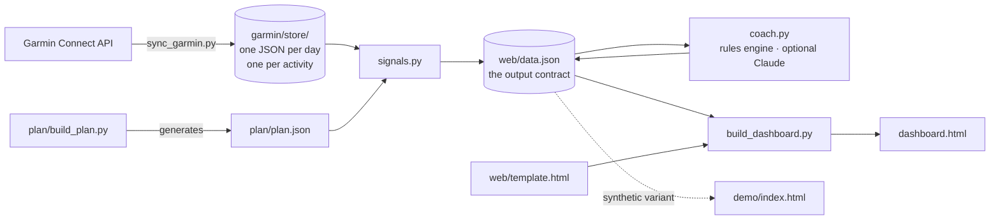

# Endurance training dashboard

A nightly pipeline that pulls my Garmin Connect data, computes the training and
recovery signals the watch doesn't give me, and renders a single self-contained
dashboard for an 8-week marathon block.

**[Live demo](https://claude.ai/artifact/Xa3zgqJ46qni6dcmnp593b)** (synthetic data) · Python 3.12 · no framework, no build step

---

## What it does

Garmin Connect will show you yesterday. It won't tell you whether your training
load is ramping faster than your body is absorbing it, whether this morning's
resting heart rate is meaningful or just noise, or whether your recent running
actually projects to the time you're chasing. Those answers need history and
arithmetic, so this pipeline keeps the history and does the arithmetic.

Every night it:

1. pulls wellness and activity data from Garmin Connect into an append-only store
2. computes the derived signals — training load, acute:chronic workload ratio,
   resting-HR baseline deviation, sleep debt, a readiness composite, a race
   projection, and adherence against the plan
3. writes a coach's read of those signals
4. renders `dashboard.html`, which opens with a double-click and needs no server

## Architecture



Each stage reads the previous stage's output from disk and nothing else, so any
stage can be run or debugged on its own.

| File | Job |
|---|---|
| `login.py` | one-time Garmin auth, including the MFA handshake; stores a reusable token |
| `sync_garmin.py` | Garmin API → `garmin/store/` plus readable markdown notes |
| `store.py` | the append-only store: one JSON file per day, one per activity |
| `signals.py` | **the analytical core.** Store + plan → `web/data.json` |
| `coach.py` | reads the signals, writes the coach's note |
| `build_dashboard.py` | inlines `web/data.json` into `web/template.html` |
| `plan/build_plan.py` | generates the 8-week plan from a single goal time |
| `make_demo_data.py` | synthetic dataset so the project can be shown publicly |
| `run_daily.py` | runs the whole pipeline; called by a launchd job at 06:30 |
| `tests/test_signals.py` | 33 tests over the signal layer |

## The decisions worth explaining

**The signals are computed in Python, not in the browser.** The interesting
numbers need history: an acute:chronic workload ratio reads 28 days of training
load, and a resting-HR baseline is meaningless against fewer than a few weeks of
mornings. Shipping a month of raw Garmin payloads to the page to recompute that
on every load would be absurd. Computing it once a night also makes it stable,
auditable and testable — `signals.py` is pure functions over plain data.

**The store is append-only, and that was a bug fix.** The first version of this
project wrote everything into a single `garmin/data.json`, rebuilt from scratch
on each run. Because the sync only pulls a trailing window, every run silently
destroyed everything older — which made the 28-day signals impossible to compute
without anyone noticing, since the dashboard rendered perfectly from 10 days of
data. The store now keeps one small file per day and per activity, and a sync
replaces only the days it actually fetched. `migrate_store.py` recovered the lost
history by parsing the human-readable markdown notes the old pipeline had written
alongside the snapshot and never deleted.

**Readiness is built from what this device actually reports.** Garmin returns no
HRV data and no Training Readiness score for my watch — both come back empty
rather than errored, which is the kind of thing that turns into a chart of zeros
if you don't check. So readiness is a weighted composite of resting-HR deviation,
sleep duration and stage composition, body battery at wake, stress, and computed
training load. Missing inputs are dropped and the remaining weights renormalised,
so a partially synced day scores on its available signals instead of being
punished for the gaps — and every score carries the list of inputs behind it,
because a score built from two signals deserves less trust than one built from
five. The dashboard names the unavailable signals rather than hiding them.

**Training load is TRIMP, not duration.** Banister's formula
(`minutes × HRr × 0.64 × e^(1.92 × HRr)`) weights hard minutes far more heavily
than easy ones, so an hour of intervals and an hour of jogging don't score alike.
Sessions without average HR fall back to a per-sport rate and are flagged as
estimated.

**The race projection reports three numbers, not one.** Riegel's formula assumes
a maximal effort, and a training run never quite is. So the projection gives the
read from the fastest-projecting run (closest to maximal), from the longest run
(where Riegel extrapolates most reliably), and from the slowest, to show the
spread. It's labelled a floor rather than a forecast.

**How alarming a pace gap is depends on the calendar.** A 20-minute gap seven
weeks out is the normal starting position for a block; the same gap in race week
is the story of the day. The coach's severity scales with days to race rather
than with the gap alone.

**The data is inlined into the page rather than fetched.** A page opened as a
local file can't `fetch()` a sibling JSON file — the browser blocks it as
cross-origin. Since the whole point is double-clicking `dashboard.html` and
seeing today's numbers, the data ships inside the page. The separation is still
real: swap `web/data.json` and you get a different dashboard, which is exactly
how the demo build works.

**Nutrition reports targets, not intake.** Garmin carries no food log, so
inventing calorie tracking here would be fiction. What can be derived honestly is
the carbohydrate target implied by the day's planned session, which is the number
that actually matters in a marathon block.

**The coach's read is a rules engine by default.** It's deterministic, free,
works offline, and can be unit-tested. `coach.py --live` instead hands the
*computed signals* — never raw payloads — to Claude and asks for the read in
plain language, falling back to the rules engine if the key is missing or the
call fails. The model never does arithmetic the pipeline has already done.

## Running it

```bash
python3 -m venv .venv && .venv/bin/pip install -r requirements.txt

.venv/bin/python login.py          # one-time Garmin auth (handles MFA)
.venv/bin/python plan/build_plan.py
.venv/bin/python run_daily.py      # sync → signals → coach → dashboard
open dashboard.html
```

Individual stages:

```bash
.venv/bin/python sync_garmin.py --days 10
.venv/bin/python signals.py --print
.venv/bin/python coach.py --live          # needs ANTHROPIC_API_KEY
.venv/bin/python run_daily.py --skip-sync # rebuild without hitting Garmin
.venv/bin/pytest tests/ -q
```

`config.json` holds the few things that can't be derived from Garmin data
(bodyweight for carb targets, an HRmax override, the sleep target, the readiness
weights). Anything left `null` is either estimated from my own history or
reported as unavailable — nothing is silently guessed.

Scheduled nightly via launchd at 06:30 (`com.garminai.dailysync`). A failed
Garmin pull doesn't take the run down: the store still holds yesterday, the
remaining stages rebuild from it, and the page says which day the data runs
through.

## Demo

`demo/index.html` is the same dashboard against a synthetic dataset from
`make_demo_data.py`. The repository is public; my resting heart rate, sleep and
location-tagged workouts are not. The real store is gitignored, and the demo
athlete is fabricated but shaped like real Garmin output — including the absent
HRV, kept absent so the demo shows the readiness model this project actually
ships rather than an idealised one. Seeded, so it's byte-identical on every run.

## Tests

33 tests over `signals.py`, covering the edge cases that would otherwise fail
quietly rather than loudly:

- a workload ratio computed from 5 days of history would look plausible and mean
  nothing, so it refuses to produce one under 21 days
- a missing readiness input must not read as a zero input
- a median baseline has to survive one sensor artifact
- an HR reading below resting must not produce negative training load
- rest days are real data, so the daily-load series is dense rather than sparse
- an empty store has to render, not crash

```bash
.venv/bin/pytest tests/ -q
```

## What's deliberately not here

- **Strava.** Garmin is the source of truth for this data; adding Strava would
  mean a second OAuth flow and a deduplication problem for no new signal.
- **A database.** 45 days of JSON files is a few hundred kilobytes. SQLite would
  be ceremony.
- **A frontend framework.** The page renders a fixed set of charts from one JSON
  object. React would be more code, not less.
